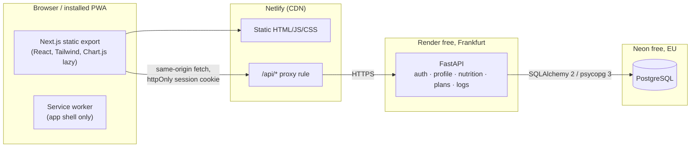

# FitPlan

A mobile-first, installable web app (PWA, Romanian UI) that acts as a personal trainer
for adults (18+) who want to lose weight, maintain, or gain muscle. It generates a gym
plan and approximate nutrition targets with **deterministic rules (no AI)**, and lets users
log workouts, food and body weight.

> **Safety first.** Every user goes through a safety screening before anything is generated.
> All health-related constants are placeholders that **must be validated by a qualified
> professional before public use**. See [Safety and limitations](#safety-and-limitations).

## Contents

- [Features](#features)
- [Architecture](#architecture)
- [Project structure](#project-structure)
- [Data model](#data-model)
- [API](#api)
- [Local setup](#local-setup)
- [Environment variables](#environment-variables)
- [Running tests and checks](#running-tests-and-checks)
- [Deployment (Neon, Render, Netlify)](#deployment-neon-render-netlify)
- [Optimizations](#optimizations)
- [Security and privacy](#security-and-privacy)
- [Safety and limitations](#safety-and-limitations)
- [Before going public](#before-going-public)

## Features

| Area | What it does |
|---|---|
| Account | Register, login, logout, change password (ends all other sessions), delete account (hard delete; regular accounts confirm with the password, guests do not have one), export all data as JSON. **Guest mode**: "Continuă ca vizitator" creates a temporary account without email/password (consent still required); its session lasts 7 days. The account and all its data are hard-deleted on logout; if the user never logs out, they are deleted by the next cleanup after the session expires (see [Guest cleanup](#guest-cleanup)). Guest data cannot be moved into a regular account. |
| Consent | Explicit consent for health-related data at registration, stored with timestamp and policy version. The app is unusable without consent for the current version. |
| Onboarding | Name, biological sex (for the formula only), birth date (18+ enforced server-side), height, weight, activity level, goal, 2–6 training days, experience, equipment (gym). |
| Safety screening | Pregnancy/breastfeeding, diagnosed medical conditions, eating-disorder history, current injuries. Any "yes" turns the app into an information-only page that recommends a doctor or accredited professional. **Only the outcome is stored, never the answers.** |
| Nutrition targets | Mifflin-St Jeor BMR × activity multiplier, moderate deficit/surplus capped by a maximum weekly rate, calorie floor, protein g/kg, minimum fat share, carbs as remainder. Always labelled as approximate. |
| Gym plan | Rule-based programs chosen by the user or automatically: Full Body (2–3 days), Upper/Lower (2, 4), Push/Pull/Legs (3, 5, 6), Bro Split (5). The plan has exactly one day per training day. 77 curated exercises (English gym names, original Romanian descriptions), each with its own rep scheme (heavy barbell lifts, machine/dumbbell compounds, isolation, hard bodyweight, calves, core, timed holds in seconds), sets adjusted by goal and experience, double-progression overload suggestions. Regenerated when plan inputs change; history kept. |
| Workout log | Start the next day of the rotation, log/edit/delete sets, finish, paginated history. Any exercise can be replaced by one with the same movement pattern and a suitable level, either for today only or permanently in the plan (sets/reps follow the new exercise). |
| Food log | Accent-insensitive search in the local foods table, private manual entries, daily totals vs targets. On request (button, not as-you-type), search in **Open Food Facts** (Romanian products, ODbL, attributed); results are cached locally, rate-limited and validated. Entries have a meal category (breakfast, lunch, dinner, snack), preselected from the time of day, and the day view is grouped by category. Recently logged foods are offered as one-tap shortcuts with the last quantity used. |
| Progress | Weight log (updates the profile weight; targets are recomputed from the 7-day average at most once per week, while the BMI rule is re-checked on every entry added or deleted), weekly averages, weight and training-volume charts with a table view. |
| Settings | Theme (dark default / light), profile edit (changing the biological sex resets the screening, which must then be taken again), retake screening, privacy policy, visible disclaimer on every app page. |

Out of scope for V1: AI features (a disabled placeholder module exists, see
[`backend/app/ai`](backend/app/ai/__init__.py)), payments, trainer roles, chat, push
notifications, native apps.

## Architecture



- The frontend is a **static export**; there is no Node server in production.
- Netlify **proxies `/api/*` to Render**, so the session cookie is first-party
  (`SameSite=Lax`). Browsers increasingly block cross-site cookies, which a direct
  Netlify → Render call would need.
- Route guards in the frontend are UX only. **The API enforces every authorization rule.**

## Project structure

```
backend/
  app/
    common/        db, security headers + CSRF, rate limiter, pagination,
                   health_constants.py  <- every value needing professional validation
    auth/          users, sessions, consent, password change, export, account deletion
    profile/       questionnaire, screening rules (screening.py, pure), ready_profile gate
    nutrition/     rules.py (pure formulas), targets, foods, food_sources/ (adapter + mock)
    plans/         exercise library model, constants.py, generator.py, progression.py (pure)
    logs/          workouts + sets, meals, weights, progress aggregates
    ai/            V2 placeholder behind FEATURE_AI_MEAL_PARSING (off)
  alembic/         migrations 0001–0012
  seed/            exercises.py (77), foods.py (20 demo foods), `python -m seed`
  tests/           unit/ (rules, generator, progression, screening) + api/ (flows, permissions)
scripts/           recompute_nutrition_cases.py (independent check of the reference cases)
frontend/
  src/app/         routes: (auth)/, (app)/ (session + consent guard), (app)/(ready)/ (profile + screening gate)
  src/features/    auth, profile, nutrition, plans, logs, progress (mirrors the backend)
  src/components/  UI primitives (Button, Card, Field, States, Disclaimer, WakeBanner)
  src/lib/         API client (CSRF, cold-start retry), hooks, formatting
  e2e/             Playwright specs
render.yaml        Render blueprint (backend)
frontend/netlify.toml  Netlify build, security headers
```

## Data model

```mermaid
erDiagram
    users ||--o{ sessions : "logs in with"
    users ||--o{ consents : "accepts"
    users ||--o| profiles : "has"
    users ||--o| nutrition_targets : "gets"
    users ||--o{ plans : "owns"
    users ||--o{ workout_sessions : "trains"
    users ||--o{ meal_logs : "eats"
    users ||--o{ weight_logs : "weighs"
    users ||--o{ foods : "adds private"
    plans ||--|{ plan_days : "contains"
    plan_days ||--|{ plan_exercises : "lists"
    exercises ||--o{ plan_exercises : "prescribed as"
    plan_days ||--o{ workout_sessions : "performed in"
    workout_sessions ||--o{ set_logs : "records"
    exercises ||--o{ set_logs : "logged as"
    workout_sessions ||--o{ workout_swaps : "overrides"
    plan_exercises ||--o{ workout_swaps : "replaced in"
    exercises ||--o{ workout_swaps : "replacement"
    foods ||--o{ meal_logs : "logged as"

    users {
        int id PK
        string email "null for guests, unique"
        string password_hash "argon2id, null for guests"
        bool is_guest
        timestamptz created_at
    }
    sessions {
        int id PK
        int user_id FK
        string token_hash "sha-256, unique"
        timestamptz expires_at
    }
    consents {
        int id PK
        int user_id FK
        string policy_version
        timestamptz accepted_at
    }
    profiles {
        int user_id PK, FK
        string display_name
        string sex
        date birth_date
        numeric height_cm
        numeric weight_kg
        string activity_level
        string goal
        int training_days "2-6"
        string experience
        string equipment
        string program
        string screening_status "outcome only"
        timestamptz screening_at
    }
    nutrition_targets {
        int user_id PK, FK
        int bmr_kcal
        int tdee_kcal
        int kcal
        int protein_g
        int fat_g
        int carbs_g
        numeric weekly_change_kg
        bool floor_applied
        numeric based_on_weight_kg
        int rules_version
    }
    exercises {
        int id PK
        string slug "unique"
        string name "English"
        text description "Romanian"
        string pattern
        string rep_scheme
        string primary_muscle
        string equipment
        string difficulty
        bool is_compound
    }
    plans {
        int id PK
        int user_id FK
        string template
        int days_per_week
        string goal
        string experience
        bool is_active "one active per user"
        timestamptz created_at
    }
    plan_days {
        int id PK
        int plan_id FK
        int position
        string name
    }
    plan_exercises {
        int id PK
        int plan_day_id FK
        int exercise_id FK
        int position
        int sets
        int reps_min
        int reps_max "reps or seconds"
        int rest_seconds
    }
    workout_sessions {
        int id PK
        int user_id FK
        int plan_day_id FK
        timestamptz started_at
        timestamptz finished_at "one open per user"
    }
    set_logs {
        int id PK
        int session_id FK
        int exercise_id FK
        int set_number
        numeric weight_kg
        int reps "reps or seconds"
    }
    workout_swaps {
        int id PK
        int session_id FK
        int plan_exercise_id FK
        int exercise_id FK
    }
    foods {
        int id PK
        string name
        string search_name "normalized, trigram index"
        numeric kcal_100g
        numeric protein_100g
        numeric carbs_100g
        numeric fat_100g
        string source "seed, manual, external"
        string external_source
        string external_id
        int owner_user_id FK "private manual foods"
    }
    meal_logs {
        int id PK
        int user_id FK
        int food_id FK
        date eaten_on
        numeric grams
        string meal_type
    }
    weight_logs {
        int id PK
        int user_id FK
        date logged_on "unique per user"
        numeric weight_kg
    }
```



15 application tables (plus `alembic_version`, Alembic's migration bookkeeping). Every user-owned table has a foreign key to `users` with `ON DELETE CASCADE`,
so deleting the user row deletes everything.

| Table | Purpose | Notable constraints / indexes |
|---|---|---|
| `users` | email (lower-cased), argon2id hash, `is_guest` | unique email; CHECK: guest or both credentials set |
| `sessions` | SHA-256 hash of the session token, expiry | unique token hash; idx user_id, expires_at |
| `consents` | policy version + accepted_at | unique (user_id, policy_version) |
| `profiles` | questionnaire (incl. program choice) + **screening outcome and timestamp only** | CHECK height 120–230, weight 30–300, days 2–6, enums |
| `nutrition_targets` | current targets, weight used, rules version | one row per user, all values ≥ 0 |
| `exercises` | library: English name, Romanian description, pattern, rep scheme, muscles, equipment, difficulty | unique slug |
| `plans` | generated plan + snapshot of inputs | partial unique index: one active plan per user; idx (user_id, created_at) |
| `plan_days` | days of a plan | unique (plan_id, position) |
| `plan_exercises` | prescription per exercise (reps, or seconds for timed holds) | sets 1–10, 1 ≤ reps_min ≤ reps_max ≤ 120, rest 30–300 s |
| `workout_sessions` | started/finished | partial unique: one open session per user; idx (user_id, started_at) |
| `workout_swaps` | exercise replaced for one session only | unique (session_id, plan_exercise_id) |
| `set_logs` | weight × reps (or seconds) | weight 0–500, reps 1–300; idx session_id, exercise_id |
| `weight_logs` | one entry per day | unique (user_id, logged_on); weight 30–300 |
| `foods` | per 100 g; global (seed/external) or private (manual) | kcal 0–900, macros sum ≤ 100; GIN trigram index; unique (external_source, external_id) |
| `meal_logs` | food + grams + meal category per day | grams 0–5000; idx (user_id, eaten_on) |

## API

All endpoints are under `/api/v1` and return JSON. Unsafe methods need the `X-CSRF-Token`
header when a session exists. Features that generate or log data require consent, a
completed profile and a passed screening (`409 profile_missing | screening_required`,
`403 professional_advice_recommended`). Other users' resources always answer `404`.

| Method | Path | Notes |
|---|---|---|
| GET | `/api/health` | Outside `/api/v1`; no DB access; used to wake the backend |
| POST | `/auth/register` · `/auth/login` · `/auth/logout` | login limited per (email, IP) and per IP, registration per IP, plus a global soft limit (`429 auth_busy`) ([DECISIONS.md](DECISIONS.md)); logout of a guest deletes the guest account |
| POST | `/auth/guest` | temporary account without credentials (`{consent: true}`), 7-day session; rate-limited per IP |
| GET | `/auth/me` | includes `is_guest` and `consent_required` |
| POST | `/auth/consent` · `/auth/password` | password change ends all sessions and starts a fresh one |
| GET / DELETE | `/account/export` · `/account` | delete needs `{password}` for regular accounts; guests send `{}` |
| GET / PUT | `/profile` | PUT recomputes targets and syncs the plan; a change of sex resets the screening |
| POST | `/profile/screening` | answers evaluated in memory, only outcome stored |
| GET | `/nutrition/targets` | `{status: ok, targets}` or `{status: blocked, reason}` |
| GET / POST | `/foods?q=` · `/foods` | local search (≥ 2 chars) · private manual food |
| GET | `/foods/external?q=` | Open Food Facts search on an explicit button press (≥ 3 chars); results cached; 4/min per user, 8/min in total; `404` when `FOOD_SOURCE=none` |
| GET | `/plans/current` · `/plans?limit&offset` · `/plans/{id}` | |
| GET / PATCH | `/plans/exercises/{id}/alternatives` · `/plans/exercises/{id}` | same pattern, suitable level · permanent swap in the active plan (`{exercise_id}`) |
| GET / POST | `/workouts/today` · `/workouts` | next rotation day + open session · start |
| GET | `/workouts?limit&offset` · `/workouts/{id}` | detail has last sets + suggestion per exercise |
| POST | `/workouts/{id}/sets` · `/workouts/{id}/finish` | set response includes `is_record` |
| POST | `/workouts/{id}/swaps` | swap for this session only (`{plan_exercise_id, exercise_id}`) |
| PATCH / DELETE | `/sets/{id}` | |
| GET / POST | `/meals?date=` · `/meals` | day entries, totals, targets |
| GET | `/meals/recent?limit=` | recently logged foods with the last quantity |
| PATCH / DELETE | `/meals/{id}` | |
| POST / DELETE | `/weights` · `/weights/{id}` | POST returns `targets_updated`; both re-apply the BMI rule |
| GET | `/progress/weight?weeks=` · `/progress/volume?weeks=` · `/progress/records` | weekly aggregates in SQL · heaviest weight per exercise |
| POST | `/internal/purge-guests` | `Authorization: Bearer <MAINTENANCE_TOKEN>`; `404` while the token is unset (see [Guest cleanup](#guest-cleanup)) |
| POST | `/ai/meal-parse` | only mounted when `FEATURE_AI_MEAL_PARSING=true`; answers `501` |

## Local setup

Requirements: Python 3.13, Node 24, Docker (or a local PostgreSQL 16+).

```bash
# 1. Database (bound to 127.0.0.1 only; the credentials are local-only dev values)
docker run -d --name fitplan-db -p 127.0.0.1:5433:5432 \
  -e POSTGRES_USER=fitplan -e POSTGRES_PASSWORD=fitplan -e POSTGRES_DB=fitplan postgres:17-alpine
docker exec fitplan-db psql -U fitplan -c "CREATE DATABASE fitplan_test;"

# 2. Backend
cd backend
python3.13 -m venv .venv
.venv/bin/pip install -r requirements-dev.txt
cp .env.example .env            # then set SECRET_KEY
.venv/bin/alembic upgrade head
.venv/bin/python -m seed        # 77 exercises + 20 demo foods (idempotent)
.venv/bin/uvicorn app.main:app --reload --port 8000

# 3. Frontend (new terminal)
cd frontend
npm install
cp .env.example .env.local      # optional; defaults work
npm run dev                     # http://localhost:3000, /api proxied to :8000
```

## Environment variables

Backend (`backend/.env.example`):

| Variable | Default | Description |
|---|---|---|
| `DATABASE_URL` | required | Postgres URL; `postgresql://` is accepted (driver added automatically) |
| `SECRET_KEY` | required | Long random string; derives CSRF tokens |
| `ALLOWED_ORIGINS` | `http://localhost:3000` | Comma-separated browser origins (production: the Netlify URL) |
| `COOKIE_SECURE` | `true` | Keep `true` in production |
| `SESSION_TTL_DAYS` | `14` | Session lifetime |
| `LOGIN_RATE_LIMIT` / `LOGIN_RATE_WINDOW_SECONDS` | `5` / `900` | Login attempts per (email, IP), and registration/guest attempts per IP, per window |
| `LOGIN_IP_RATE_LIMIT` | `20` | Login attempts per IP across all emails, per window |
| `AUTH_GLOBAL_LIMIT` | `300` | Whole-app login + registration + guest attempts per window; above it the API answers `429 auth_busy` |
| `TRUSTED_PROXY_HOPS` | `0` | `X-Forwarded-For` entries added by trusted proxies, counted from the right; `1` on Render ([DECISIONS.md](DECISIONS.md)) |
| `PROXY_SECRET` | empty | Shared with Netlify; only requests carrying it in `X-FitPlan-Proxy-Secret` may name the visitor IP (`X-Nf-Client-Connection-Ip`); ≥ 32 characters |
| `LOG_CLIENT_IP_RESOLUTION` | `false` | Deploy check only: logs how the client IP was resolved (masked /24 or /48) |
| `APP_TIMEZONE` | `Europe/Bucharest` | Groups workouts into local weeks |
| `FOOD_SOURCE` | `none` | External food database: `none`, `open_food_facts` (or `mock` in tests) |
| `OFF_USER_AGENT` | placeholder | Identifies the app to Open Food Facts: `App/Version (contact email)` |
| `FEATURE_AI_MEAL_PARSING` | `false` | V2 placeholder; keep `false` |
| `MAINTENANCE_TOKEN` | empty (disabled) | Bearer token for the scheduled guest cleanup endpoint; ≥ 32 characters |

Frontend (`frontend/.env.example`): `DEV_API_URL` (dev proxy target), and for the Netlify
build only `BACKEND_URL` (the https URL of the Render service) and `PROXY_SECRET` (same
value as on Render). Set both in the Netlify UI with the **Builds** scope.

Secrets never go in the repository; `.env*` files are git-ignored except the examples.

## Running tests and checks

```bash
# Backend: lint, format, types, migrations in sync, tests (needs the fitplan_test DB)
cd backend
.venv/bin/ruff check . && .venv/bin/ruff format --check . && .venv/bin/mypy
.venv/bin/alembic check
.venv/bin/pytest

# Frontend: lint, format, types, production build
cd frontend
npm run lint && npm run format:check && npm run typecheck && npm run build

# End-to-end (starts backend + Next dev server; needs a migrated + seeded dev DB)
npx playwright install chromium   # first time only
npm run e2e
```

Backend tests cover the nutrition formulas (hand-computed expected values), safety
screening and BMI rules, plan generation, progression, every main API flow, and
**cross-user access for every resource** (plans, workouts, sets, foods, meals, weights).
Playwright covers register → onboarding → plan → log workout → log food → progress, the
screening "refer" path, and the cold-start retry.

CI (`.github/workflows/ci.yml`) runs all of the above on every push and pull request.

## Deployment (Neon, Render, Netlify)

All three have free tiers. Choose EU regions everywhere.

1. **Neon (database)**: create a project in an EU region (e.g. Frankfurt). Copy the
   connection string (keep `sslmode=require`).
2. **Render (backend)**: *New → Blueprint* and select this repo (`render.yaml`), or create
   a Python web service with root `backend`, region **Frankfurt**, and the build/start
   commands from `render.yaml`. Set `DATABASE_URL` (Neon) and `ALLOWED_ORIGINS`
   (your Netlify URL). `SECRET_KEY`, `MAINTENANCE_TOKEN` and `PROXY_SECRET` are generated.
   Migrations and the idempotent seed run on every start.
3. **Netlify (frontend)**: import the repo with **base directory `frontend`**
   (`netlify.toml` provides build command, publish dir, headers and the `/api/*` proxy
   rule). Set `BACKEND_URL` to the Render URL (e.g. `https://fitplan-api.onrender.com`)
   and `PROXY_SECRET` to the value Render generated, both with the Builds scope.
   `scripts/configure-proxy.mjs` writes them into the proxy rule during the build and fails
   the build if either is missing. Netlify passes cookies through the proxy; API responses
   carry `Cache-Control: no-store`, so they are never cached.
4. Open the Netlify URL, register, and check *Settings → Exportă datele*.
5. Set up the [guest cleanup](#guest-cleanup).
6. Run the [post-deploy client IP check](#post-deploy-client-ip-check).

### Post-deploy client IP check

Rate limiting depends on how the client IP is resolved ([DECISIONS.md](DECISIONS.md)),
and two parts of it are not confirmed by Netlify's or Render's docs. After every deploy
that touches the proxy, `render.yaml` or the secret:

1. On Render, set `LOG_CLIENT_IP_RESOLUTION=true` (the service restarts).
2. Send one request **through Netlify** and one **directly to Render**, each with a forged
   header, from a network whose public IP you know:

   ```bash
   body='{"email":"check@example.com","password":"not-the-password"}'
   for base in https://<site>.netlify.app https://<service>.onrender.com; do
     curl -s -o /dev/null -w "$base %{http_code}\n" -X POST "$base/api/v1/auth/login" \
       -H 'Content-Type: application/json' -H 'X-Forwarded-For: 1.2.3.4' \
       -H 'X-Nf-Client-Connection-Ip: 5.6.7.8' -H 'X-FitPlan-Proxy-Secret: guess' -d "$body"
   done
   ```

3. Compare the two `client_ip source=... prefix=...` lines in the Render logs:
   - through Netlify: `source=netlify` and **your** network's prefix. `netlify-fallback`
     means Netlify did not send the visitor header (limits still work, but per-IP limits
     are off; see DECISIONS.md). `direct` means the secret did not arrive: check
     `PROXY_SECRET` on both sides and rebuild Netlify.
   - directly to Render: `source=direct` and your network's prefix.
   - neither line may show `1.2.3.0/24` or `5.6.7.0/24` (the forged values).
4. Set `LOG_CLIENT_IP_RESOLUTION=false` again.

### Guest cleanup

Expired guest accounts (session older than 7 days) are deleted with all their data by
`POST /api/v1/internal/purge-guests`. The endpoint needs `Authorization: Bearer
<MAINTENANCE_TOKEN>` and answers 404 while `MAINTENANCE_TOKEN` is unset. The workflow
[`.github/workflows/purge-guests.yml`](.github/workflows/purge-guests.yml) calls it daily
(03:17 UTC, with retries for a sleeping backend) and can also be started by hand.

To enable it, add two repository secrets in GitHub (*Settings → Secrets and variables →
Actions*):

- `FITPLAN_API_URL`: the Render URL, e.g. `https://fitplan-api.onrender.com`;
- `FITPLAN_MAINTENANCE_TOKEN`: the same value as `MAINTENANCE_TOKEN` on Render.

Until both secrets exist, the workflow skips itself and expired guests are only removed
opportunistically (on the next login, registration or guest start). GitHub may start
scheduled runs late, so deletion happens within roughly a day after expiry, not at an
exact time.

### Cold starts on free tiers

- **Render free** stops the service after about 15 minutes without traffic. The next
  request can take **30–60 s** while it starts.
- **Neon free** suspends compute after a few minutes idle. Waking it adds well under a
  second, and `pool_pre_ping` drops stale connections.
- The **Netlify proxy has a shorter timeout** than a Render cold start, so the first
  request after sleeping can fail with 502/503/504.

How the app handles it (`frontend/src/lib/api.ts`):

1. Before talking to a possibly sleeping backend, the client polls `GET /api/health`
   (no DB access) with backoff (1, 2, 4, 8, 15, 15 s). It shows a banner
   "Serverul pornește…" if the check takes longer than 1.5 s.
2. Only then are real requests sent, so non-idempotent requests (POST/PATCH/DELETE)
   are **never retried or duplicated**. GET requests are also retried on 502/503/504.
3. After a successful response the backend is considered awake for 10 minutes.

`e2e/cold-start.spec.ts` simulates a sleeping backend. An external uptime ping could keep
the instance awake, but it counts against Render's free hours and is not set up.

## Optimizations

| Optimization | Where |
|---|---|
| Indexes on every `user_id` + date access path, partial unique indexes, GIN trigram index for food search | models / migrations |
| Pagination without COUNT queries (fetch `limit + 1`) | `common/pagination.py`; plans and workout history |
| No N+1: `selectinload` for plan → days → exercises; one aggregate query for workout history; two queries for "last sets" of all exercises (`DISTINCT ON`); weekly weight/volume aggregated in SQL | `plans/service.py`, `logs/service.py` |
| Food lookups cached in the DB: external results are inserted into `foods` (`ON CONFLICT DO NOTHING`); the source is only queried when the user presses the search button, and the same term is not sent again for 24 h | `nutrition/service.py` |
| Accent-insensitive search via a stored normalized column (no runtime `unaccent`) | `foods.search_name` |
| Small DB pool (5 + 2) suited to free-tier connection limits; `pool_pre_ping` for Neon autosuspend | `common/db.py` |
| Static generation for every page (static export); public pages are fully prerendered | `next.config.ts` |
| Small bundle: no UI/data-fetching libraries (own 40-line hook); Chart.js tree-shaken (only used controllers registered) and loaded lazily with `next/dynamic` (one chunk of 161 KB raw / 56 KB gzip, measured on 2026-10-17 with `next build`, loaded only by the progress page) | `features/progress` |
| Fonts self-hosted at build time by `next/font` (no runtime third-party request) | `app/layout.tsx` |
| Images: no raster images in the UI; icons are pre-sized PNGs (192/512/180) plus one SVG. `next/image` optimization is unavailable in a static export, so nothing relies on it | `public/` |
| Immutable caching for hashed assets; service worker caches the app shell only | `netlify.toml`, `public/sw.js` |
| Rate limiting on login (per IP and per email + IP) and registration (per IP); counters pruned in the background | `auth/router.py`, `common/rate_limit.py` |
| Respect `prefers-reduced-motion` (CSS and chart animations) | `globals.css`, `Charts.tsx` |

## Security and privacy

- Passwords: argon2id. Login timing is uniform for unknown emails.
- Sessions: random 256-bit token in an **httpOnly, Secure, SameSite=Lax** cookie. Only its
  SHA-256 is stored. Logout deletes the session (and the whole account for guests). A
  password change or account deletion invalidates all sessions.
- Rate limiting: login per (email, IP) and per IP, registration and guest start per IP,
  plus a global soft limit. The visitor IP comes from Netlify's
  `X-Nf-Client-Connection-Ip` only when the request carries the Netlify proxy secret
  (constant-time comparison). Otherwise the address that connected to Render is used
  (the `X-Forwarded-For` entry Render adds); client-supplied values are never used
  ([DECISIONS.md](DECISIONS.md)).
- CSRF: Origin check plus a double-submit token bound to the session (HMAC).
- Security headers on API and static site (CSP, HSTS, nosniff, frame-deny,
  referrer-policy, permissions-policy). The static site's CSP allows `'unsafe-inline'`
  scripts because the Next.js static export inlines its bootstrap data.
- All input validated server-side (Pydantic + DB CHECK constraints); age is computed on the server.
- Users can only access their own data, enforced in every query and tested.
- No third-party trackers or analytics. No health data in logs: Render runs uvicorn with
  `--no-access-log`; SQL errors never include bound parameters (`hide_parameters=True`);
  unhandled exceptions are answered with a plain 500 and logged as exception type, route
  template and code locations only, never the message (Postgres error messages quote the
  failing row).
- In memory only, never written anywhere: rate-limiter keys (IP, email + IP), dropped
  once outside the 15-minute window, and Open Food Facts search terms, removed in under
  24 hours by a background pruning thread.
- Deletion: account deletion and guest cleanup hard-delete the rows immediately. Neon
  keeps a history of the database for its point-in-time restore window (set per project
  in Neon), so deleted rows stay recoverable there until that window passes.
- Minimal data: the screening answers are never stored, only the outcome. Manual foods
  are private.
- EU hosting: Neon and Render in Frankfurt. Netlify serves static files from its global CDN
  and proxies API calls.

## Safety and limitations

### Screening

Before any target or plan is generated, the user answers four yes/no questions
(pregnancy/breastfeeding, diagnosed medical condition, history of eating disorders,
current injury). **Any "yes"** means:

- no calorie or macro targets, no weight-loss goal, no gym plan, no logging;
- a generic page that recommends a doctor or accredited professional, without naming the condition;
- the user can retake the screening later; export and account deletion remain available.

Weight-loss goals are also blocked when BMI is below `BMI_MIN_FOR_WEIGHT_LOSS`. This is
checked when the profile is saved, on every target recompute, and on every weight entry
added or deleted, against the current weight: weight-loss targets disappear as soon as
the user crosses the threshold, without waiting for the weekly recompute. A weekly
recompute also checks the current weight, so a 7-day average above the threshold cannot
hide it.

Changing the biological sex in the profile resets the screening outcome, because the
pregnancy question depends on it. Targets and the plan are withheld until the screening
is taken again.

### Constants that a qualified professional must validate

All of them are in **two files**, with comments:

- [`backend/app/common/health_constants.py`](backend/app/common/health_constants.py):
  minimum age, BMI threshold, Mifflin-St Jeor coefficients, activity multipliers,
  deficit/surplus fractions, maximum weekly loss/gain, kcal per kg, calorie floors,
  protein g/kg, minimum fat share.
- [`backend/app/plans/constants.py`](backend/app/plans/constants.py): sets/reps/rest per rep scheme,
  goal and experience, exercises per session, overload increments, split templates.

Also to review: the screening question wording (`frontend/src/features/profile/ScreeningForm.tsx`)
and the exercise descriptions (`backend/seed/exercises.py`). After changing a formula or
constant, bump `RULES_VERSION` in `nutrition/rules.py`.

### How the formulas were checked

What has been done, and nothing more:

1. **Unit tests with hand-derived values.** `tests/unit/test_nutrition_rules.py` checks every
   step (BMR, TDEE, deficit/surplus cap, calorie floor, macro split, edge cases). The
   arithmetic is written in the test comments.
2. **Independent recomputation.** The three cases below are recomputed by
   [`scripts/recompute_nutrition_cases.py`](scripts/recompute_nutrition_cases.py), which
   does not import FitPlan code, uses exact fractions and its own copy of the constants,
   and exits with an error on any mismatch (`python3 scripts/recompute_nutrition_cases.py`).
   All values match the app, and they are pinned in
   `tests/unit/test_nutrition_reference_cases.py`.

These checks show that **the code computes what the formulas and constants say**. They do
not show that the formulas or constants are appropriate for users. **No health constant
has been validated.** A qualified professional (physician / registered dietitian, and a
certified coach for the training constants) must review every value in
`backend/app/common/health_constants.py` and `backend/app/plans/constants.py` before
public use.

Not done yet: a comparison with a public Mifflin-St Jeor (BMR) calculator. To do it,
enter the inputs below and compare **BMR** and **TDEE** (± 1 kcal for rounding). Target
calories and macros depend on FitPlan's own constants, so other calculators will differ
there by design.

| Case | Inputs | BMR | TDEE | Target | Protein / Fat / Carbs (g) |
|---|---|---|---|---|---|
| A | Female, 30 y, 168 cm, 70 kg, moderate (×1.55), lose | 1439 | 2230.45 | 1780 (−20 %, under the 577.5 kcal cap) | 140 / 49 / 194 |
| B | Male, 25 y, 180 cm, 80 kg, active (×1.725), gain | 1805 | 3113.63 | 3330 (+220 weekly-rate cap, not +10 %) | 144 / 93 / 479 (fat 92.5 g rounded half up) |
| C | Male, 45 y, 175 cm, 95 kg, light (×1.375), maintain | 1823.75 | 2507.66 | 2510 | 152 / 70 / 318 |

### Known limitations

- All values are **approximate population-level estimates**, not individual advice. The
  disclaimer is shown on every app page.
- The calorie floor can raise a "lose" target to or above maintenance for very small,
  sedentary users. The UI says so when the floor is applied.
- Protein uses total body weight. At high BMI this may overestimate needs (flagged for review).
- Bodyweight exercises are logged with 0 kg extra load, so they add no training volume.
- Demo foods are rounded reference values. Open Food Facts data is crowd-sourced and may
  contain errors; see [`food_sources/LICENSING.md`](backend/app/nutrition/food_sources/LICENSING.md).
- The rate limiter is in memory (single instance, reset on restart). That
  `X-Nf-Client-Connection-Ip` reaches proxied requests is based on a Netlify forum
  announcement, not Netlify's docs; without it, per-IP limits are skipped for traffic
  through Netlify. Many attackers with distinct IPs can trip the global soft limit and
  pause logins for everyone for up to 15 minutes. See [DECISIONS.md](DECISIONS.md).
- The privacy policy contains placeholders for operator identity and contact, and needs
  legal review.

## Before going public

The code is ready for deployment, but these items are open. Most of them are not
technical:

1. **Professional validation.** A qualified professional must review every value in
   `backend/app/common/health_constants.py` and `backend/app/plans/constants.py`, the
   screening wording and the exercise descriptions.
2. **Privacy policy.** Fill in the operator and contact placeholders, and have a lawyer
   review the policy, including the processing agreements with Neon, Render and Netlify
   and any transfers outside the EU.
3. **Guest cleanup.** Set `MAINTENANCE_TOKEN` on Render and the two GitHub secrets
   (see [Guest cleanup](#guest-cleanup)). The privacy policy promises the daily cleanup.
4. **Open Food Facts.** Set `OFF_USER_AGENT`, fill in OFF's API usage form, and settle how to
   meet ODbL section 4.6 for the locally cached products. The full list is in
   [`food_sources/LICENSING.md`](backend/app/nutrition/food_sources/LICENSING.md).
5. **Client IP check.** Run the [post-deploy client IP check](#post-deploy-client-ip-check)
   and keep `TRUSTED_PROXY_HOPS` in line with what Render adds.
6. **Neon restore window.** Check the project's history retention in Neon. The privacy
   policy says deleted data stays in Neon's restore history until that window passes.
