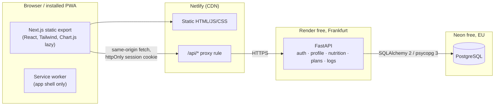

# FitPlan

A mobile-first, installable web app (PWA, Romanian UI) that acts as a personal trainer
for adults (18+) who want to lose weight, maintain, or gain muscle. It generates a gym
plan and approximate nutrition targets with **deterministic rules (no AI)**, and lets users
log workouts, food and body weight.

> **Safety first.** Every user goes through a safety screening before anything is generated.
> All health-related constants are placeholders that **must be validated by a qualified
> professional before public use**. See [Safety and limitations](#safety-and-limitations).

## Contents

- [Features](#features)
- [Architecture](#architecture)
- [Project structure](#project-structure)
- [Data model](#data-model)
- [API](#api)
- [Local setup](#local-setup)
- [Environment variables](#environment-variables)
- [Running tests and checks](#running-tests-and-checks)
- [Deployment (Neon, Render, Netlify)](#deployment-neon-render-netlify)
- [Optimizations](#optimizations)
- [Security and privacy](#security-and-privacy)
- [Safety and limitations](#safety-and-limitations)

## Features

| Area | What it does |
|---|---|
| Account | Register, login, logout, change password (ends all other sessions), delete account (hard delete), export all data as JSON. **Guest mode**: "Continuă ca vizitator" creates a temporary account without email/password (consent still required); it is hard-deleted on logout or once its 7-day session expires (expired guests are purged on the next login, registration or guest start, since the free tier has no scheduler). Guest data cannot be moved into a regular account. |
| Consent | Explicit consent for health-related data at registration, stored with timestamp and policy version. The app is unusable without consent for the current version. |
| Onboarding | Name, biological sex (for the formula only), birth date (18+ enforced server-side), height, weight, activity level, goal, 2–6 training days, experience, equipment (gym). |
| Safety screening | Pregnancy/breastfeeding, diagnosed medical conditions, eating-disorder history, current injuries. Any "yes" turns the app into an information-only page that recommends a doctor or accredited professional. **Only the outcome is stored, never the answers.** |
| Nutrition targets | Mifflin-St Jeor BMR × activity multiplier, moderate deficit/surplus capped by a maximum weekly rate, calorie floor, protein g/kg, minimum fat share, carbs as remainder. Always labelled as approximate. |
| Gym plan | Rule-based programs chosen by the user or automatically: Full Body (2–3 days), Upper/Lower (2, 4), Push/Pull/Legs (3, 5, 6), Bro Split (5). The plan has exactly one day per training day. 77 curated exercises (English gym names, original Romanian descriptions), each with its own rep scheme (heavy barbell lifts, machine/dumbbell compounds, isolation, hard bodyweight, calves, core, timed holds in seconds), sets adjusted by goal and experience, double-progression overload suggestions. Regenerated when plan inputs change; history kept. |
| Workout log | Start the next day of the rotation, log/edit/delete sets, finish, paginated history. Any exercise can be replaced by one with the same movement pattern and a suitable level, either for today only or permanently in the plan (sets/reps follow the new exercise). |
| Food log | Accent-insensitive search in the local foods table, private manual entries, daily totals vs targets. External food DB adapter interface + mock only. |
| Progress | Weight log (updates the profile weight; targets are recomputed from the 7-day average at most once per week), weekly averages, weight and training-volume charts with a table view. |
| Settings | Theme (dark default / light), profile edit, retake screening, privacy policy, visible disclaimer on every app page. |

Out of scope for V1: AI features (a disabled placeholder module exists, see
[`backend/app/ai`](backend/app/ai/__init__.py)), payments, trainer roles, chat, push
notifications, native apps.

## Architecture



- The frontend is a **static export**; there is no Node server in production.
- Netlify **proxies `/api/*` to Render**, so the session cookie is first-party
  (`SameSite=Lax`). Browsers increasingly block cross-site cookies, which a direct
  Netlify → Render call would need.
- Route guards in the frontend are UX only. **The API enforces every authorization rule.**

## Project structure

```
backend/
  app/
    common/        db, security headers + CSRF, rate limiter, pagination,
                   health_constants.py  <- every value needing professional validation
    auth/          users, sessions, consent, password change, export, account deletion
    profile/       questionnaire, screening rules (screening.py, pure), ready_profile gate
    nutrition/     rules.py (pure formulas), targets, foods, food_sources/ (adapter + mock)
    plans/         exercise library model, constants.py, generator.py, progression.py (pure)
    logs/          workouts + sets, meals, weights, progress aggregates
    ai/            V2 placeholder behind FEATURE_AI_MEAL_PARSING (off)
  alembic/         migrations 0001–0006
  seed/            exercises.py (77), foods.py (20 demo foods), `python -m seed`
  tests/           unit/ (rules, generator, progression, screening) + api/ (flows, permissions)
frontend/
  src/app/         routes: (auth)/, (app)/ (session + consent guard), (app)/(ready)/ (profile + screening gate)
  src/features/    auth, profile, nutrition, plans, logs, progress (mirrors the backend)
  src/components/  UI primitives (Button, Card, Field, States, Disclaimer, WakeBanner)
  src/lib/         API client (CSRF, cold-start retry), hooks, formatting
  e2e/             Playwright specs
render.yaml        Render blueprint (backend)
frontend/netlify.toml  Netlify build, security headers
```

## Data model

15 tables. Every user-owned table has a foreign key to `users` with `ON DELETE CASCADE`,
so deleting the user row deletes everything.

| Table | Purpose | Notable constraints / indexes |
|---|---|---|
| `users` | email (lower-cased), argon2id hash, `is_guest` | unique email; CHECK: guest or both credentials set |
| `sessions` | SHA-256 hash of the session token, expiry | unique token hash; idx user_id, expires_at |
| `consents` | policy version + accepted_at | unique (user_id, policy_version) |
| `profiles` | questionnaire + **screening outcome and timestamp only** | CHECK height 120–230, weight 30–300, days 2–6, enums |
| `nutrition_targets` | current targets, weight used, rules version | one row per user, all values ≥ 0 |
| `exercises` | library: pattern, muscles, equipment, difficulty | unique slug |
| `plans` | generated plan + snapshot of inputs | partial unique index: one active plan per user; idx (user_id, created_at) |
| `plan_days` | days of a plan | unique (plan_id, position) |
| `plan_exercises` | prescription per exercise | sets 1–10, 1 ≤ reps_min ≤ reps_max ≤ 30, rest 30–300 s |
| `workout_sessions` | started/finished | partial unique: one open session per user; idx (user_id, started_at) |
| `workout_swaps` | exercise replaced for one session only | unique (session_id, plan_exercise_id) |
| `set_logs` | weight × reps | weight 0–500, reps 1–100; idx session_id, exercise_id |
| `weight_logs` | one entry per day | unique (user_id, logged_on); weight 30–300 |
| `foods` | per 100 g; global (seed/external) or private (manual) | kcal 0–900, macros sum ≤ 100; GIN trigram index; unique (external_source, external_id) |
| `meal_logs` | food + grams per day | grams 0–5000; idx (user_id, eaten_on) |

## API

All endpoints are under `/api/v1` and return JSON. Unsafe methods need the `X-CSRF-Token`
header when a session exists. Features that generate or log data require consent, a
completed profile and a passed screening (`409 profile_missing | screening_required`,
`403 professional_advice_recommended`). Other users' resources always answer `404`.

| Method | Path | Notes |
|---|---|---|
| GET | `/api/health` | No DB access; used to wake the backend |
| POST | `/auth/register` · `/auth/login` · `/auth/logout` | login/register rate-limited |
| GET | `/auth/me` | includes `consent_required` |
| POST | `/auth/consent` · `/auth/password` | password change ends all sessions |
| GET / DELETE | `/account/export` · `/account` | delete requires the password |
| GET / PUT | `/profile` | PUT recomputes targets and syncs the plan |
| POST | `/profile/screening` | answers evaluated in memory, only outcome stored |
| GET | `/nutrition/targets` | `{status: ok, targets}` or `{status: blocked, reason}` |
| GET / POST | `/foods?q=` · `/foods` | search (≥ 2 chars) · private manual food |
| GET | `/plans/current` · `/plans?limit&offset` · `/plans/{id}` | |
| GET / POST | `/workouts/today` · `/workouts` | next rotation day + open session · start |
| GET | `/workouts?limit&offset` · `/workouts/{id}` | detail has last sets + suggestion per exercise |
| POST | `/workouts/{id}/sets` · `/workouts/{id}/finish` | |
| PATCH / DELETE | `/sets/{id}` | |
| GET / POST | `/meals?date=` · `/meals` | day entries, totals, targets |
| PATCH / DELETE | `/meals/{id}` | |
| POST / DELETE | `/weights` · `/weights/{id}` | POST returns `targets_updated` |
| GET | `/progress/weight?weeks=` · `/progress/volume?weeks=` | weekly aggregates in SQL |

## Local setup

Requirements: Python 3.13, Node 24, Docker (or a local PostgreSQL 16+).

```bash
# 1. Database (bound to 127.0.0.1 only; the credentials are local-only dev values)
docker run -d --name fitplan-db -p 127.0.0.1:5433:5432 \
  -e POSTGRES_USER=fitplan -e POSTGRES_PASSWORD=fitplan -e POSTGRES_DB=fitplan postgres:17-alpine
docker exec fitplan-db psql -U fitplan -c "CREATE DATABASE fitplan_test;"

# 2. Backend
cd backend
python3.13 -m venv .venv
.venv/bin/pip install -r requirements-dev.txt
cp .env.example .env            # then set SECRET_KEY
.venv/bin/alembic upgrade head
.venv/bin/python -m seed        # 77 exercises + 20 demo foods (idempotent)
.venv/bin/uvicorn app.main:app --reload --port 8000

# 3. Frontend (new terminal)
cd frontend
npm install
cp .env.example .env.local      # optional; defaults work
npm run dev                     # http://localhost:3000, /api proxied to :8000
```

## Environment variables

Backend (`backend/.env.example`):

| Variable | Default | Description |
|---|---|---|
| `DATABASE_URL` | required | Postgres URL; `postgresql://` is accepted (driver added automatically) |
| `SECRET_KEY` | required | Long random string; derives CSRF tokens |
| `ALLOWED_ORIGINS` | `http://localhost:3000` | Comma-separated browser origins (production: the Netlify URL) |
| `COOKIE_SECURE` | `true` | Keep `true` in production |
| `SESSION_TTL_DAYS` | `14` | Session lifetime |
| `LOGIN_RATE_LIMIT` / `LOGIN_RATE_WINDOW_SECONDS` | `5` / `900` | Attempts per IP and per email per window |
| `APP_TIMEZONE` | `Europe/Bucharest` | Groups workouts into local weeks |
| `FOOD_SOURCE` | `none` | External food adapter: `none` or `mock` |
| `FEATURE_AI_MEAL_PARSING` | `false` | V2 placeholder; keep `false` |

Frontend (`frontend/.env.example`): `DEV_API_URL` (dev proxy target) and `BACKEND_URL`
(Netlify build only; the https URL of the Render service).

Secrets never go in the repository; `.env*` files are git-ignored except the examples.

## Running tests and checks

```bash
# Backend: lint, format, types, migrations in sync, tests (needs the fitplan_test DB)
cd backend
.venv/bin/ruff check . && .venv/bin/ruff format --check . && .venv/bin/mypy
.venv/bin/alembic check
.venv/bin/pytest

# Frontend: lint, format, types, production build
cd frontend
npm run lint && npm run format:check && npm run typecheck && npm run build

# End-to-end (starts backend + Next dev server; needs a migrated + seeded dev DB)
npx playwright install chromium   # first time only
npm run e2e
```

Backend tests cover the nutrition formulas (hand-computed expected values), safety
screening and BMI rules, plan generation, progression, every main API flow, and
**cross-user access for every resource** (plans, workouts, sets, foods, meals, weights).
Playwright covers register → onboarding → plan → log workout → log food → progress, the
screening "refer" path, and the cold-start retry.

CI (`.github/workflows/ci.yml`) runs all of the above on every push and pull request.

## Deployment (Neon, Render, Netlify)

All three have free tiers. Choose EU regions everywhere.

1. **Neon (database)**: create a project in an EU region (e.g. Frankfurt). Copy the
   connection string (keep `sslmode=require`).
2. **Render (backend)**: *New → Blueprint* and select this repo (`render.yaml`), or create
   a Python web service with root `backend`, region **Frankfurt**, and the build/start
   commands from `render.yaml`. Set `DATABASE_URL` (Neon) and `ALLOWED_ORIGINS`
   (your Netlify URL). `SECRET_KEY` is generated. Migrations and the idempotent seed run
   on every start.
3. **Netlify (frontend)**: import the repo with **base directory `frontend`**
   (`netlify.toml` provides build command, publish dir and headers). Set `BACKEND_URL`
   to the Render URL (e.g. `https://fitplan-api.onrender.com`). The build writes
   `out/_redirects` with the `/api/*` proxy rule. Netlify passes cookies through the proxy;
   API responses carry `Cache-Control: no-store`, so they are never cached.
4. Open the Netlify URL, register, and check *Settings → Exportă datele*.

### Cold starts on free tiers

- **Render free** stops the service after about 15 minutes without traffic. The next
  request can take **30–60 s** while it starts.
- **Neon free** suspends compute after a few minutes idle. Waking it adds well under a
  second, and `pool_pre_ping` drops stale connections.
- The **Netlify proxy has a shorter timeout** than a Render cold start, so the first
  request after sleeping can fail with 502/503/504.

How the app handles it (`frontend/src/lib/api.ts`):

1. Before talking to a possibly sleeping backend, the client polls `GET /api/health`
   (no DB access) with backoff (1, 2, 4, 8, 15, 15 s). It shows a banner
   "Serverul pornește…" if the check takes longer than 1.5 s.
2. Only then are real requests sent, so non-idempotent requests (POST/PATCH/DELETE)
   are **never retried or duplicated**. GET requests are also retried on 502/503/504.
3. After a successful response the backend is considered awake for 10 minutes.

`e2e/cold-start.spec.ts` simulates a sleeping backend. An external uptime ping could keep
the instance awake, but it counts against Render's free hours and is not set up.

## Optimizations

| Optimization | Where |
|---|---|
| Indexes on every `user_id` + date access path, partial unique indexes, GIN trigram index for food search | models / migrations |
| Pagination without COUNT queries (fetch `limit + 1`) | `common/pagination.py`; plans and workout history |
| No N+1: `selectinload` for plan → days → exercises; one aggregate query for workout history; two queries for "last sets" of all exercises (`DISTINCT ON`); weekly weight/volume aggregated in SQL | `plans/service.py`, `logs/service.py` |
| Food lookups cached in the DB: external results are inserted into `foods` (`ON CONFLICT DO NOTHING`); the source is only queried when local results are few | `nutrition/service.py` |
| Accent-insensitive search via a stored normalized column (no runtime `unaccent`) | `foods.search_name` |
| Small DB pool (5 + 2) suited to free-tier connection limits; `pool_pre_ping` for Neon autosuspend | `common/db.py` |
| Static generation for every page (static export); public pages are fully prerendered | `next.config.ts` |
| Small bundle: no UI/data-fetching libraries (own 40-line hook); Chart.js tree-shaken (only used controllers registered) and loaded lazily with `next/dynamic` (~54 KB gzip chunk, only on the progress page) | `features/progress` |
| Fonts self-hosted at build time by `next/font` (no runtime third-party request) | `app/layout.tsx` |
| Images: no raster images in the UI; icons are pre-sized PNGs (192/512/180) plus one SVG. `next/image` optimization is unavailable in a static export, so nothing relies on it | `public/` |
| Immutable caching for hashed assets; service worker caches the app shell only | `netlify.toml`, `public/sw.js` |
| Rate limiting on login (per IP and per email) and registration (per IP) | `auth/router.py` |
| Respect `prefers-reduced-motion` (CSS and chart animations) | `globals.css`, `Charts.tsx` |

## Security and privacy

- Passwords: argon2id. Login timing is uniform for unknown emails.
- Sessions: random 256-bit token in an **httpOnly, Secure, SameSite=Lax** cookie. Only its
  SHA-256 is stored. Logout deletes the session. A password change or account deletion
  invalidates all sessions.
- CSRF: Origin check plus a double-submit token bound to the session (HMAC).
- Security headers on API and static site (CSP, HSTS, nosniff, frame-deny,
  referrer-policy, permissions-policy). The static site's CSP allows `'unsafe-inline'`
  scripts because the Next.js static export inlines its bootstrap data.
- All input validated server-side (Pydantic + DB CHECK constraints); age is computed on the server.
- Users can only access their own data, enforced in every query and tested.
- No third-party trackers or analytics. No health data in logs: the app has no logging
  of request data and Render runs uvicorn with `--no-access-log`.
- Minimal data: the screening answers are never stored, only the outcome. Manual foods
  are private.
- EU hosting: Neon and Render in Frankfurt. Netlify serves static files from its global CDN
  and proxies API calls.

## Safety and limitations

### Screening

Before any target or plan is generated, the user answers four yes/no questions
(pregnancy/breastfeeding, diagnosed medical condition, history of eating disorders,
current injury). **Any "yes"** means:

- no calorie or macro targets, no weight-loss goal, no gym plan, no logging;
- a generic page that recommends a doctor or accredited professional, without naming the condition;
- the user can retake the screening later; export and account deletion remain available.

Weight-loss goals are also blocked when BMI is below `BMI_MIN_FOR_WEIGHT_LOSS`. This is
checked when the profile is saved and on every target recompute, including recomputes
triggered by new weight entries.

### Constants that a qualified professional must validate

All of them are in **two files**, with comments:

- [`backend/app/common/health_constants.py`](backend/app/common/health_constants.py):
  minimum age, BMI threshold, Mifflin-St Jeor coefficients, activity multipliers,
  deficit/surplus fractions, maximum weekly loss/gain, kcal per kg, calorie floors,
  protein g/kg, minimum fat share.
- [`backend/app/plans/constants.py`](backend/app/plans/constants.py): sets/reps/rest per rep scheme,
  goal and experience, exercises per session, overload increments, split templates.

Also to review: the screening question wording (`frontend/src/features/profile/ScreeningForm.tsx`)
and the exercise descriptions (`backend/seed/exercises.py`). After changing a formula or
constant, bump `RULES_VERSION` in `nutrition/rules.py`.

### How I validated the formulas

1. **Source formulas.** BMR uses the Mifflin-St Jeor equation as published (Mifflin et al.,
   *Am J Clin Nutr* 1990;51:241–247): `10·kg + 6.25·cm − 5·age + 5` (men) / `− 161` (women).
   The activity multipliers are the commonly used 1.2 / 1.375 / 1.55 / 1.725 / 1.9.
2. **Unit tests with hand-derived values.** `tests/unit/test_nutrition_rules.py` checks every
   step (BMR, TDEE, deficit/surplus cap, calorie floor, macro split, edge cases). The
   arithmetic is written in the test comments.
3. **Independent recomputation.** The three cases below were recomputed by a separate
   script that does not import FitPlan code and uses exact fractions. All values matched
   the app, and they are pinned in `tests/unit/test_nutrition_reference_cases.py`.
4. **Sources checked online (October 2026).**
   - Mifflin-St Jeor coefficients match the original paper
     ([doi:10.1093/ajcn/51.2.241](https://doi.org/10.1093/ajcn/51.2.241)).
   - Calorie floors of 1,200 (women) / 1,500 (men) kcal/day match Harvard Health's
     [Calorie counting made easy](https://www.health.harvard.edu/staying-healthy/calorie-counting-made-easy).
   - Protein of 1.6–2.0 g/kg sits within the ISSN position stand's 1.4–2.0 g/kg
     ([PMC5477153](https://www.ncbi.nlm.nih.gov/pmc/articles/PMC5477153/)).
   - The minimum fat share of 25 % is within the IOM range of 20–35 %.
   - The activity multipliers are conventional; no single primary source was found.
   - **Open point:** the 2013 AHA/ACC/TOS guideline mentions a 500–750 kcal/day deficit.
     FitPlan's 20 % deficit (capped by the weekly rate) is smaller for many users, e.g.
     446 kcal in case A. This is a decision for the reviewing professional.
5. **Not done yet: comparison with a public calculator.** Enter the inputs below into a
   trusted Mifflin-St Jeor calculator and compare **BMR** and **TDEE** (± 1 kcal for
   rounding). The target calories and macros depend on FitPlan's own deficit, surplus and
   macro constants, so other calculators will differ there by design.

| Case | Inputs | BMR | TDEE | Target | Protein / Fat / Carbs (g) |
|---|---|---|---|---|---|
| A | Female, 30 y, 168 cm, 70 kg, moderate (×1.55), lose | 1439 | 2230.45 | 1780 (−20 %, under the 577.5 kcal cap) | 140 / 49 / 194 |
| B | Male, 25 y, 180 cm, 80 kg, active (×1.725), gain | 1805 | 3113.63 | 3330 (+220 weekly-rate cap, not +10 %) | 144 / 92 / 481 |
| C | Male, 45 y, 175 cm, 95 kg, light (×1.375), maintain | 1823.75 | 2507.66 | 2510 | 152 / 70 / 318 |

Validation by a qualified professional is still required: these checks prove the code
implements the formulas correctly, not that the constants are right for users.

### Known limitations

- All values are **approximate population-level estimates**, not individual advice. The
  disclaimer is shown on every app page.
- The calorie floor can raise a "lose" target to or above maintenance for very small,
  sedentary users. The UI says so when the floor is applied.
- Protein uses total body weight. At high BMI this may overestimate needs (flagged for review).
- Bodyweight exercises are logged with 0 kg extra load, so they add no training volume.
- Demo foods are rounded reference values. Connecting a real database requires following
  [`food_sources/LICENSING.md`](backend/app/nutrition/food_sources/LICENSING.md).
- The rate limiter is in memory (single instance). Behind proxies the per-IP limit relies on
  `X-Forwarded-For`, which can be spoofed; the per-email limit still applies.
- The privacy policy contains placeholders for operator identity and contact, and needs
  legal review.
