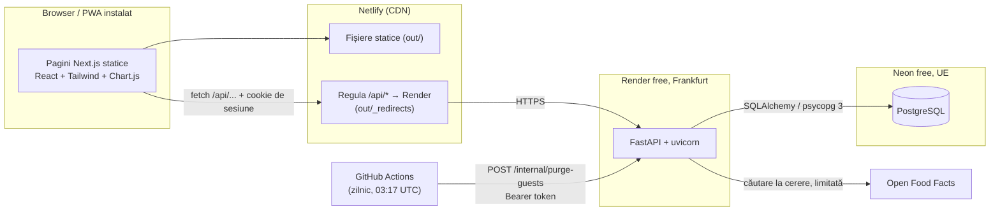

# FitPlan – Arhitectura, explicată simplu

Document de învățare: cum funcționează aplicația, de ce e construită așa și unde cauți când ceva nu merge.
Pentru detalii de instalare și deploy vezi [README.md](../README.md).

---

## 1. Imaginea de ansamblu

FitPlan are trei bucăți mari:

- **Frontend** – pagini HTML/JS statice (Next.js exportat), servite de **Netlify**.
- **Backend** – un API **FastAPI** (Python) care rulează pe **Render** (plan gratuit).
- **Baza de date** – **PostgreSQL** găzduit pe **Neon** (plan gratuit).

Plus două servicii externe: **Open Food Facts** (căutare alimente) și **GitHub Actions** (rulează zilnic curățenia conturilor de vizitator).

**Ideea cheie:** browserul crede că vorbește cu un singur site (Netlify). Netlify trimite în spate tot ce începe cu `/api/` către Render. De aceea cookie-ul de sesiune e „first-party” și nu e blocat de browser.

### O cerere urmărită cap-coadă: „înregistrez o serie la antrenament”

Utilizatorul scrie 60 kg × 8 repetări și apasă „Salvează”.

| Pas | Ce se întâmplă | Unde e codul |
|---|---|---|
| 1 | Componenta de antrenament apelează `addSet(...)` | `frontend/src/features/logs/WorkoutLogger.tsx` → `features/logs/api.ts` |
| 2 | Clientul API comun verifică dacă backendul e treaz (`/api/health`), citește cookie-ul `fitplan_csrf` și îl pune în header-ul `X-CSRF-Token` | `frontend/src/lib/api.ts` (`ensureAwake`, `api`) |
| 3 | Browserul trimite `POST /api/v1/workouts/{id}/sets` către Netlify, cu cookie-ul `fitplan_session` atașat automat | – |
| 4 | Netlify vede regula `/api/*` și redirecționează cererea la Render | `frontend/scripts/write-redirects.mjs` |
| 5 | Middleware-ul de securitate verifică **Origin** și **tokenul CSRF** (HMAC). Dacă nu se potrivesc → 403 | `backend/app/common/security.py` |
| 6 | FastAPI rulează „dependențele” rutei, în lanț: `current_user` (cookie → hash SHA-256 → caută sesiunea în DB) → `consented_user` (are consimțământ pentru versiunea curentă?) → `ready_profile` (are profil și screening trecut?) | `auth/dependencies.py`, `profile/dependencies.py` |
| 7 | Ruta `add_set` validează corpul cererii cu Pydantic (`SetIn`) și cheamă serviciul | `backend/app/logs/router.py` |
| 8 | Serviciul caută antrenamentul **doar printre ale acestui utilizator** (`_own_session`: `WHERE id = ? AND user_id = ?`). Dacă nu e al lui → 404. Verifică apoi că exercițiul face parte din antrenament, calculează numărul seriei, salvează și verifică dacă e record personal | `backend/app/logs/service.py` (`add_set`) |
| 9 | Răspuns JSON `{..., is_record: true/false}` + headere de securitate (`Cache-Control: no-store` etc.) | `common/security.py` |

Regula de reținut: **frontendul doar ascunde/arată lucruri; backendul decide ce e permis.**

---

## 2. Tehnologiile (ce fac, de ce, ce costă)

| Tehnologie | Ce face aici | De ce, față de o alternativă | Un dezavantaj (tradeoff) |
|---|---|---|---|
| **FastAPI** | Tot API-ul: rute, validare (Pydantic), dependențe pentru autentificare | vs **Django**: mai mic, validare automată din tipuri, ușor de testat. Django ar fi dat gratis admin, sesiuni și CSRF | Securitatea (sesiuni, CSRF, rate limiting) e scrisă de mână → mai mult cod de întreținut și mai mult loc pentru greșeli |
| **PostgreSQL** | Stochează tot; constrângeri (CHECK, unique, `ON DELETE CASCADE`), index trigram pentru căutarea alimentelor | vs **SQLite**: suportă mai mulți utilizatori simultan, există gratuit hostat (Neon), are `pg_trgm` | Ai nevoie de un server; pe Neon free baza „adoarme” și prima cerere e mai lentă |
| **SQLAlchemy 2** | ORM: clase Python ↔ tabele; interogări cu `select(...)` | vs **SQL brut**: mai puțin cod repetitiv, tipuri verificate de mypy | Încă un strat de învățat; e ușor să scrii fără să vrei interogări ineficiente (N+1) |
| **Alembic** | Migrări: istoric versionat al schemei (`0001`–`0012`) | vs `Base.metadata.create_all()`: poți modifica o bază existentă fără să pierzi date. CI rulează `alembic check` ca să prindă diferențe model ↔ migrare | Migrările se scriu/verifică manual; pe Render rulează la fiecare pornire (încetinește cold start-ul) |
| **Next.js (static export)** | UI-ul React, rutare pe foldere; build-ul produce fișiere statice în `out/` | vs **Vite + React Router**: rutare și structură gata făcute | Sincer: e cea mai discutabilă alegere. Cu export static nu folosești nimic din partea de server a Next.js (SSR, rute API). Vite ar fi fost mai simplu. Plus: în dev se folosesc `rewrites`, în producție `_redirects`, deci două mecanisme diferite pentru același proxy |
| **Tailwind CSS** | Stilizare direct în clase (`className="p-4 ..."`), temă dark/light | vs **CSS Modules**: rapid de scris, fără fișiere CSS separate, CSS final mic | JSX-ul devine lung și greu de citit; e ușor să repeți aceleași combinații de clase |
| **Chart.js** | Graficele de greutate și volum, încărcate lazy (doar pe pagina de progres) | vs **Recharts**: mai mic, merge pe canvas, rapid | Nu e „React-native”: trebuie un wrapper; accesibilitatea e slabă, de aceea există și vizualizare tabel |
| **Playwright** | Teste end-to-end în browser real (fluxuri, cold start simulat) | vs **Cypress**: mai rapid, mai multe browsere, gratuit în CI | Teste mai lente și mai fragile; au nevoie de backend + bază de date pornite |
| **pytest** | Teste unitare (reguli pure) și teste API pe o bază PostgreSQL reală | vs **unittest**: fixture-uri simple, mai puțin cod | Testele API au nevoie de Postgres (nu merg „din cutie” fără Docker) |

**Ce aș schimba:**
1. **Vite** în loc de Next.js static export, ca să fie mai simplu.
2. **Rate limiting într-un loc comun** (Redis sau tabel în Postgres), ca să meargă cu mai multe instanțe (vezi secțiunea 5).
3. Migrări rulate ca pas separat de deploy, nu la fiecare pornire (pe planul plătit de Render).

---

## 3. Structura folderelor – unde cauți ce

Backendul și frontendul au aceleași „feature-uri” (auth, profile, nutrition, plans, logs), deci un bug se caută în perechea de foldere cu același nume.

### Backend (`backend/app/`)

Fiecare modul are de obicei: `models.py` (tabele), `schemas.py` (forma JSON a cererilor/răspunsurilor), `router.py` (rutele HTTP), `service.py` (logica și interogările). Fișierele „pure” (fără bază de date) conțin regulile.

| Modul | Ce face | Cauți aici când… |
|---|---|---|
| `main.py` | Creează aplicația, adaugă middleware-uri și rute, `/api/health` | o rută nu există, ordinea middleware-urilor |
| `config.py` | Setări din variabile de mediu | o setare nu se aplică |
| `common/` | `db.py` (conexiune), `security.py` (CSRF, headere), `rate_limit.py`, `pagination.py`, `errors.py`, `health_constants.py` | 403 `csrf_failed`, probleme de conexiune, constante de sănătate |
| `auth/` | Conturi, parole, sesiuni, consimțământ, vizitatori, export, ștergere cont, curățenie | login, cookie, 401/403, conturi de vizitator |
| `profile/` | Chestionar, `screening.py` (reguli pure), poarta `ready_profile` | 409 `profile_missing` / `screening_required`, vârstă, IMC |
| `nutrition/` | `rules.py` (formule pure), ținte, alimente, `food_sources/` (Open Food Facts + mock) | calorii/macro greșite, căutare alimente |
| `plans/` | `constants.py` (serii/repetări), `generator.py`, `progression.py` (pure), înlocuire exerciții | plan greșit, sugestii de progres |
| `logs/` | Antrenamente, serii, mese, greutate, statistici de progres | salvare serie/masă, istoric, grafice |
| `ai/` | Placeholder V2, oprit (`FEATURE_AI_MEAL_PARSING=false`) | – |
| `models.py` | Importă toate modelele (ca Alembic să le vadă) | `alembic check` dă diferențe |

Alte foldere: `backend/alembic/versions/` (migrări), `backend/seed/` (77 exerciții, 20 alimente demo), `backend/tests/unit/` și `backend/tests/api/`.

### Frontend (`frontend/src/`)

| Folder | Ce face | Cauți aici când… |
|---|---|---|
| `app/` | Paginile (rutare pe foldere). `(auth)/` = login/înregistrare; `(app)/` = cere sesiune + consimțământ; `(app)/(ready)/` = cere profil + screening | o pagină, redirecționări |
| `features/<nume>/` | Componentele și `api.ts` pentru fiecare zonă | UI-ul și apelurile unei funcționalități |
| `components/` | Butoane, carduri, câmpuri, `WakeBanner`, `Disclaimer` | aspect comun |
| `lib/api.ts` | Clientul HTTP: CSRF, trezirea backendului, erori | erori de rețea, 403 CSRF, cold start |
| `e2e/` | Teste Playwright | – |

Configurare: `render.yaml` (backend), `frontend/netlify.toml` + `scripts/write-redirects.mjs` (frontend și proxy), `.github/workflows/` (CI și curățenie).

---

## 4. Modelul de date

**Răspunsul corect: 15 tabele ale aplicației.** Am numărat `__tablename__` în modele și `create_table` în migrări: în ambele sunt exact 15. În baza reală mai există o tabelă, `alembic_version`, care doar ține minte ce migrare a rulat. Deci 16 cu tot cu ea. Cifra **17 nu apare nicidecum în repo și nici în istoricul git** (istoricul arată 14 → 15 când s-a adăugat `workout_swaps`). Dacă ai văzut 17 undeva, sursa e greșită.

| Tabelă | La ce folosește |
|---|---|
| `users` | Contul: email, hash de parolă (argon2id), `is_guest` |
| `sessions` | Sesiunile de login: **hash-ul** tokenului și data expirării |
| `consents` | Ce versiune a politicii de confidențialitate a acceptat utilizatorul și când |
| `profiles` | Datele din chestionar + **doar rezultatul** screening-ului (nu răspunsurile) |
| `nutrition_targets` | Țintele calculate: kcal, proteine, grăsimi, carbohidrați |
| `exercises` | Biblioteca de 77 de exerciții (comună tuturor) |
| `plans` | Un plan generat; maxim unul activ per utilizator, cele vechi rămân ca istoric |
| `plan_days` | Zilele unui plan (ex. „Upper”, „Lower”) |
| `plan_exercises` | Ce exerciții are fiecare zi, cu serii/repetări/pauză |
| `workout_sessions` | Un antrenament făcut; maxim unul deschis per utilizator |
| `set_logs` | Fiecare serie înregistrată (greutate, repetări sau secunde) |
| `workout_swaps` | Înlocuirea unui exercițiu doar pentru antrenamentul de azi |
| `foods` | Alimente: din seed, adăugate manual (private) sau din Open Food Facts (cache) |
| `meal_logs` | Ce a mâncat utilizatorul, cât și la ce masă |
| `weight_logs` | Cântăririle |

Toate tabelele care aparțin unui utilizator au cheie străină spre `users` cu `ON DELETE CASCADE`: când ștergi utilizatorul, baza șterge automat tot ce e al lui.

---

## 5. Securitatea, pe înțelesul tuturor

| Mecanism | Cum funcționează | Cod | Teste care o dovedesc |
|---|---|---|---|
| **Parole** | Nu se salvează parola, ci un hash **argon2id** (lent intenționat, ca să fie greu de spart). Pentru emailuri inexistente se verifică un hash fals, ca timpul de răspuns să nu dezvăluie dacă emailul există | `auth/service.py` | `test_login_wrong_password`, `test_register_validates_password_length` (indirect; niciun test nu verifică explicit formatul argon2id) |
| **Sesiuni** | La login se generează un token aleator (256 biți). Browserul îl primește în cookie; în DB se pune doar **SHA-256** al lui, deci un DB furat nu conține tokenuri folosibile. Expiră după 14 zile (vizitatori: 7). Schimbarea parolei șterge toate sesiunile | `auth/service.py` | `test_logout_invalidates_session`, `test_password_change_invalidates_all_other_sessions`, `test_me_requires_session` |
| **Cookie-uri** | `fitplan_session`: `HttpOnly` (JavaScript nu-l poate citi → protecție XSS), `Secure` (doar HTTPS), `SameSite=Lax`. `fitplan_csrf`: citibil de JS, folosit pentru CSRF | `auth/router.py` | `test_register_sets_httponly_secure_session_and_records_consent` |
| **CSRF** | Două straturi la POST/PATCH/DELETE: (1) header-ul `Origin`, dacă există, trebuie să fie în lista permisă; (2) header-ul `X-CSRF-Token` trebuie să fie egal cu `HMAC(SECRET_KEY, token sesiune)`. Un site străin nu poate citi cookie-ul tău CSRF, deci nu poate trimite header-ul corect | `common/security.py` | `test_unsafe_request_without_csrf_token_is_rejected`, `test_request_from_foreign_origin_is_rejected` |
| **Rate limiting** | Numără încercările într-o fereastră de timp, **în memoria procesului**. Login: 5 / 15 min per pereche (email, IP) și 20 / 15 min per IP, deci un străin nu poate bloca contul altcuiva. Înregistrare și vizitator: 5 / 15 min per IP. Open Food Facts: 4/min per utilizator, 8/min în total. IP-ul e ultima intrare din `X-Forwarded-For` (adăugată de Render), nu prima, pe care o poate scrie clientul (vezi [DECISIONS.md](../DECISIONS.md)). Un fir de fundal șterge cheile expirate | `common/client_ip.py`, `common/rate_limit.py`, `auth/router.py`, `nutrition/service.py` | `test_blocks_after_limit_and_recovers_after_window`, `test_login_is_rate_limited`, `test_spoofed_left_most_values_do_not_bypass_the_limit`, `test_stranger_cannot_lock_the_owner_out`, `test_external_search_is_rate_limited_per_user` |
| **Izolarea datelor** | Fiecare interogare filtrează după `user_id` (ex. `_own_session`, `_own_set`, `_own_meal`). Dacă resursa e a altcuiva → **404** (nu 403, ca să nu confirme că există) | `logs/service.py` și celelalte `service.py` | `test_users_cannot_touch_each_others_workouts`, `test_users_cannot_touch_each_others_meals`, `test_cannot_read_another_users_plan`, `test_weight_validation_and_isolation`, `test_guests_are_isolated_from_each_other`, `test_manual_food_is_private` |
| **Loguri fără date personale** | Erorile SQL nu includ parametrii (`hide_parameters=True`). O excepție neprinsă devine un 500 simplu și se loghează doar tipul, ruta (șablonul, fără valori) și locul din cod, niciodată mesajul: Postgres pune rândul care a eșuat în mesaj | `common/db.py`, `common/security.py` | `test_unhandled_errors_are_logged_without_values`, `test_engine_hides_sql_parameters` |
| **Endpoint de curățenie** | Cere `Authorization: Bearer <MAINTENANCE_TOKEN>`, comparat în timp constant; fără token configurat răspunde 404 | `auth/router.py` | `test_purge_endpoint_rejects_wrong_token`, `test_purge_endpoint_disabled_without_token` |

**Limite reale (sincer):**
- Rate limiter-ul e în memorie: se resetează la fiecare restart (pe Render free, după fiecare „adormire”) și nu funcționează cu mai multe instanțe.
- În spatele proxy-ului Netlify, „IP-ul” e adresa Netlify, comună multor vizitatori, deci limita pe IP la înregistrare se poate atinge mai ușor în perioade aglomerate. Numărul de intrări adăugate de Render în `X-Forwarded-For` vine din forumul Render, nu din documentația oficială, și nu a fost verificat pe serviciul live. Detalii în [DECISIONS.md](../DECISIONS.md).
- (Rezolvat) Înainte, uvicorn rula cu `--forwarded-allow-ips='*'` și lua prima intrare din `X-Forwarded-For`, pe care clientul o putea falsifica.

---

## 6. Logica de sănătate

**Toate constantele** sunt în `backend/app/common/health_constants.py` (nutriție, vârstă, IMC), iar cele de antrenament în `backend/app/plans/constants.py`. Toate sunt marcate **PLACEHOLDER**.

**Screening** (`profile/screening.py`): 4 întrebări da/nu (sarcină/alăptare, boală diagnosticată, istoric de tulburări alimentare, accidentare). **Un singur „da” → `REFER`**: aplicația nu generează nimic și recomandă un specialist. Se salvează doar rezultatul. Dacă utilizatorul își schimbă sexul în profil, rezultatul se resetează și screening-ul trebuie refăcut (întrebarea despre sarcină depinde de sex). Separat: vârsta minimă e 18 ani (verificată pe server), iar obiectivul „slăbire” e blocat dacă IMC < 18,5. Regula IMC rulează la salvarea profilului și la fiecare greutate adăugată sau ștearsă, pe greutatea curentă, deci țintele de slăbire dispar imediat ce pragul e depășit (recalcularea săptămânală din media pe 7 zile rămâne).

**Nutriție** (`nutrition/rules.py`, funcții pure):
1. BMR cu **Mifflin-St Jeor**: `10×kg + 6,25×cm − 5×vârstă + (5 bărbați / −161 femei)`.
2. TDEE = BMR × factor de activitate (1,2 … 1,9).
3. Slăbire: −20% din TDEE; masă: +10%. Limitat așa încât schimbarea să nu depășească 0,75%/săpt. din greutate (slăbire) sau 0,25% (masă), cu 7700 kcal ≈ 1 kg.
4. Minim de calorii: 1500 (bărbați) / 1200 (femei).
5. Macro: proteine 2,0 / 1,6 / 1,8 g/kg (slăbire / menținere / masă), grăsimi minim 25% din calorii, restul carbohidrați.

**Planul** (`plans/generator.py`, `progression.py`): alegi un program (Full Body, Upper/Lower, PPL, Bro Split) sau se alege automat după zile/săptămână. Fiecare zi are tipare de mișcare; pentru fiecare se alege un exercițiu potrivit nivelului de experiență. Serii/repetări vin din `PRESCRIPTION[rep_scheme][goal]`. Progresia e „double progression”: când atingi repetările maxime la toate seriile, se sugerează mai multă greutate: +5 kg la exercițiile compuse pentru picioare (genuflexiuni, hinge, fandări) și +2,5 kg la toate celelalte.

**Ce trebuie validat de un profesionist** (medic, dietetician, antrenor/kinetoterapeut): toate cele de mai sus, în special pragul IMC (are nevoie de o marjă?), minimul de calorii, ritmul maxim de slăbire, proteinele la IMC mare (greutatea totală poate supraestima), factorii de activitate, volumul de antrenament și întrebările de screening.

---

## 7. Setup-ul pe planurile gratuite

**Cold start.** Render free oprește serviciul după ~15 minute fără trafic. Pornirea durează 30–60 s sau mai mult, pentru că la fiecare start rulează `alembic upgrade head`, apoi seed-ul, apoi uvicorn. Neon „adoarme” și el; `pool_pre_ping=True` reface conexiunile moarte.
Frontendul se ocupă de asta în `lib/api.ts`: înainte de cereri cheamă `/api/health` (nu atinge baza de date), reîncearcă la 1, 2, 4, 8, 15, 15 secunde, afișează `WakeBanner` dacă durează și consideră backendul treaz 10 minute după un răspuns reușit. Cererile POST/PATCH/DELETE **nu** sunt repetate automat (ar putea crea dubluri). Se reîncearcă ping-ul de health, iar cererile GET sunt reîncercate și la 502/503/504.

**Proxy.** Build-ul Netlify rulează `npm run build && node scripts/write-redirects.mjs`. Scriptul scrie `out/_redirects` cu `/api/*  https://<render>/api/:splat  200!`. `200` înseamnă „proxy, nu redirect”, deci URL-ul din browser rămâne Netlify și cookie-urile sunt same-site. În dev, același lucru îl face `rewrites` din `next.config.ts`.

**Curățenie.** Conturile de vizitator expirate se șterg (1) oportunist, la login/înregistrare/start vizitator, și (2) zilnic, de `.github/workflows/purge-guests.yml`, care face `curl` cu reîncercări (backendul poate dormi) la `/api/v1/internal/purge-guests`. Sesiunile expirate ale unui utilizator se șterg când își face login.

**Ce se poate strica:**
- Proxy-ul Netlify are timeout mai scurt decât un cold start → primele cereri dau 502/504 (acoperit de ping-ul de health).
- `BACKEND_URL` lipsă la build → nu se scrie `_redirects`, toate apelurile `/api` dau 404 (scriptul doar avertizează, nu oprește build-ul).
- `ALLOWED_ORIGINS` greșit → toate POST-urile dau 403 `csrf_failed`.
- Secretele GitHub lipsă → curățenia e sărită cu un simplu warning; GitHub poate dezactiva workflow-urile programate în repo-uri inactive 60 de zile.
- Rate limiter-ul se resetează la fiecare adormire (vezi secțiunea 5).
- O migrare care eșuează la start → serviciul nu pornește deloc.
- Limitele planurilor gratuite (ore Render, compute/stocare Neon) pot opri serviciul.

---

## Anexă: unde documentația nu se potrivea cu codul (corectat)

1. **README, „Project structure”**: scria `migrations 0001–0006`; acum `0001`–`0012`.
2. **`next.config.ts`**: comentariul spunea că proxy-ul e în `netlify.toml`; acum spune corect că regula e scrisă de `scripts/write-redirects.mjs` în `out/_redirects`.
3. **README, API / Security**: limita pe IP putea fi ocolită prin `X-Forwarded-For`. Rezolvat (vezi secțiunea 5 și [DECISIONS.md](../DECISIONS.md)).
4. **„17 tabele”**: nu apare nicăieri; corect este 15 (16 cu `alembic_version`).
